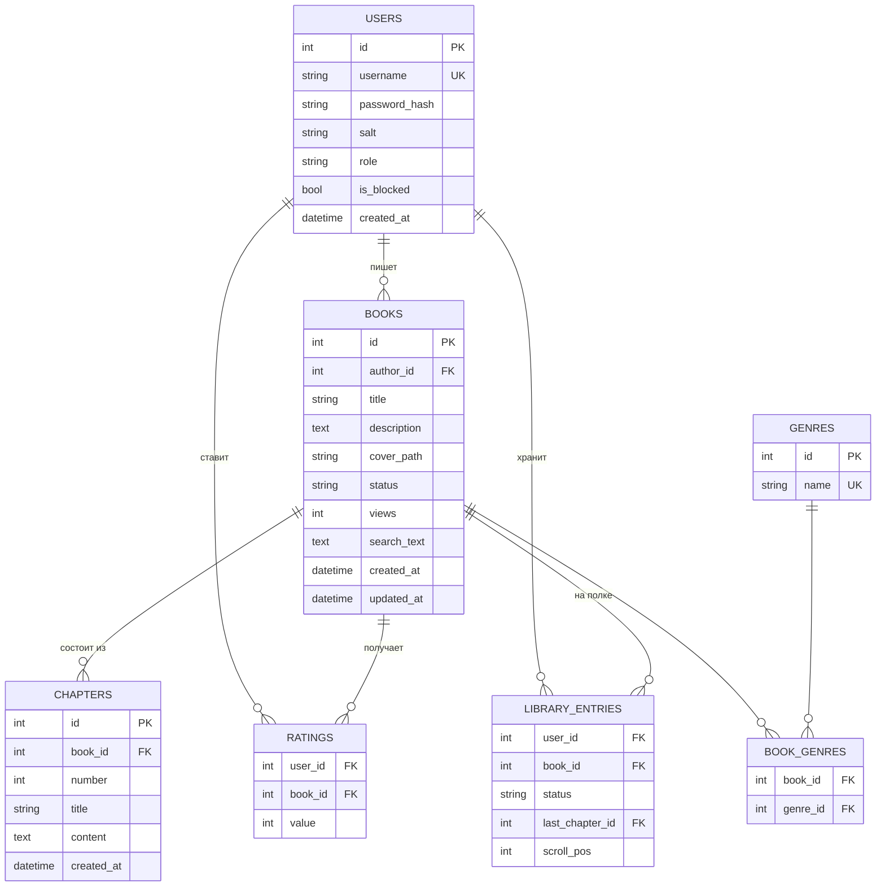

# Author Yesterday

Десктопная книжная платформа: авторы публикуют книги по главам, читатели ищут, читают, оценивают и собирают личную библиотеку.

## АНАЛИТИКА ПРОЕКТА: «Author Yesterday»
Автор: Гаврилов Н.С.

### 1. ЧТО ЭТО И ЗАЧЕМ (СУТЬ)
**Что делаем:** настольную книжную платформу по образцу Author.Today — каталог, страницы книг, читалку, библиотеку, кабинет автора и админ-панель.
**Зачем:** читателю — быстро найти книгу и продолжить с места остановки, автору — публиковать текст по главам без сайта и вёрстки.

### 2. ДЛЯ КОГО (ЦЕЛЕВАЯ АУДИТОРИЯ)
**Основные пользователи:** читатели, начинающие авторы и модераторы небольшого литературного сообщества.
**Их главная задача в приложении:** найти и читать книги главами; публиковать и дополнять свои книги; поддерживать порядок в каталоге.

### 3. НА ЧЁМ ДЕЛАЕМ (СТЕК)
**Клиентская часть:** Python 3.12, PySide6, Pillow, шрифты PT Serif и PT Sans.
**Серверная часть:** отсутствует — локальное приложение со встроенной БД.
**База данных:** SQLite через SQLAlchemy 2.x.
**Внешние сервисы:**
- GitHub Actions — сборка exe и публикация релизов.

### 4. ЧТО СОЗДАЁМ (КОМПОНЕНТЫ ПРИЛОЖЕНИЯ)
**Роли пользователей:**
- Читатель — поиск, чтение, оценки, библиотека;
- Автор — то же плюс CRUD своих книг и глав;
- Администратор — жанры, пользователи (блокировка, роли), удаление любых книг.
**Основные экраны и модули:**
1. Экран входа и регистрации — авторизация и создание аккаунта читателя или автора.
2. Экран каталога — карточки, поиск, фильтры, сортировка.
3. Экран книги — описание, рейтинг, оглавление, добавление в библиотеку.
4. Экран читалки — размер шрифта, тема, переход по главам, сохранение позиции.
5. Экран библиотеки — полки и «Продолжить чтение».
6. Экран «Мои книги» и редакторы — книги, обложки, главы.
7. Экран администрирования — пользователи, книги, жанры.
**Ключевые сущности (данные):**
- Пользователь, Книга, Глава, Жанр, Оценка, Запись библиотеки.

### 5. ГЛАВНЫЙ КРИТЕРИЙ УСПЕХА
**Метрика:** новый пользователь находит книгу через поиск или фильтр и открывает первую главу в течение 1 минуты после регистрации.

## Схема БД



## Возможности

- Вход и регистрация, профиль со сменой имени и пароля, блокировка пользователей.
- Каталог: поиск по кириллице без учёта регистра, фильтры по жанрам, статусу и рейтингу, сортировка.
- Оценки 1–5, библиотека с полками «Читаю», «В планах», «Прочитано».
- Читалка с размером шрифта, светлой и тёмной темой и сохранением позиции.
- CRUD книг и глав с загрузкой обложек, админ-панель.
- 12 произведений русской литературы полностью, 186 глав в демо-данных.
- При первом запуске база заполняется в фоне с индикатором прогресса; ошибки пишутся в `author_yesterday.log` в папке данных.

## Запуск из исходников

```bash
python -m venv .venv
source .venv/bin/activate          # Windows: .venv\Scripts\activate
pip install -r requirements.txt
python -m app.main
```

## Сборка exe

Готовый exe — на странице [Releases](https://github.com/SatoNistOne/author-yesterday/releases). Ручная сборка на Windows:

```bash
pip install -r requirements.txt pyinstaller
pyinstaller --onefile --windowed --name AuthorYesterday --icon assets/icon.ico --add-data "assets;assets" app/main.py
```

## Демо-аккаунты

| Роль | Логин | Пароль |
|---|---|---|
| Администратор | `admin` | `admin123` |
| Читатель | `reader` | `reader123` |
| Авторы | `pushkin`, `gogol`, `lermontov`, `dostoevsky`, `odoevsky`, `kuprin`, `grin`, `belyaev`, `bogdanov`, `atolstoy`, `bulgakov`, `zamyatin` | `author123` |

## Тесты

```bash
pip install pytest
pytest
```
